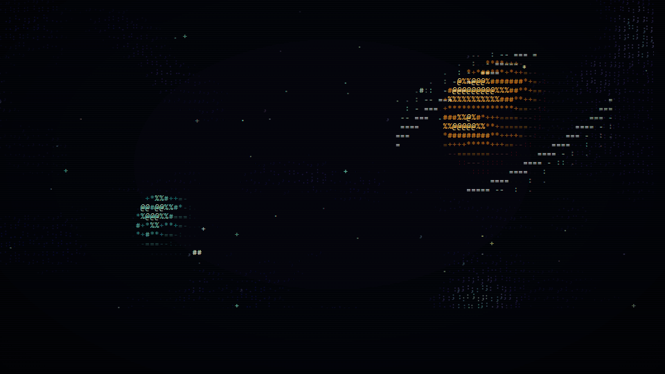
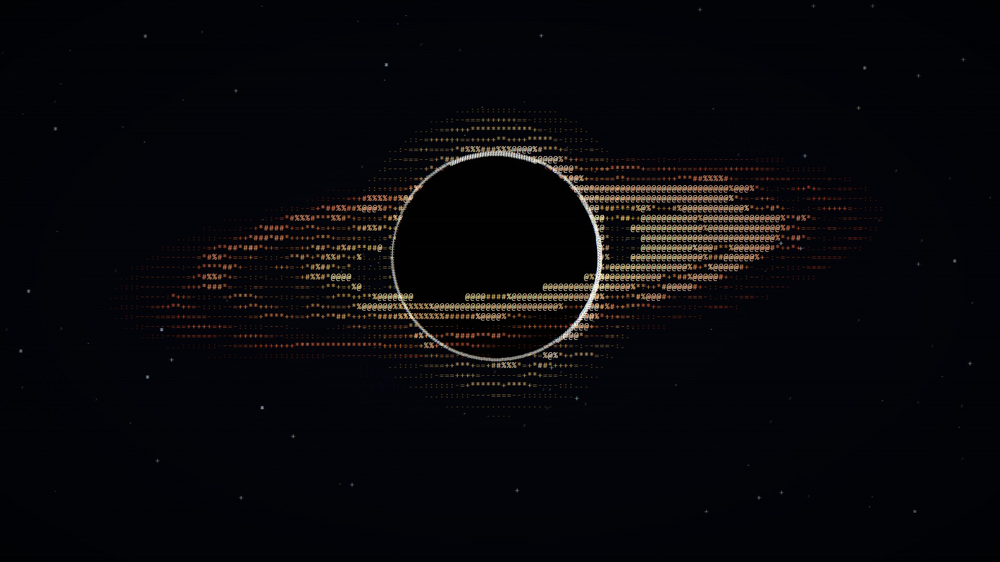

<div align="center">

# ASCII Wallpapers

**Fondos de pantalla animados dibujados con caracteres ASCII — para [Wallpaper Engine](https://www.wallpaperengine.io/) y cualquier navegador.**

Cada planeta, estrella y nebulosa se dibuja con glifos monoespaciados sobre un `<canvas>`.
Sin imágenes, sin vídeo y sin peticiones de red: cada fondo de pantalla es un proyecto web autónomo.

[](LICENSE)
[](https://www.wallpaperengine.io/)
[](#características)
[](CONTRIBUTING.md)
[](https://github.com/NemoKing1210)

[English](README.md) · [Русский](README.ru.md) · [**Español**](README.es.md) · [Deutsch](README.de.md) · [Français](README.fr.md) · [Português (BR)](README.pt-BR.md) · [简体中文](README.zh-CN.md) · [日本語](README.ja.md)



</div>

## Características

- **Renderizado ASCII puro** — planetas, anillos, estrellas y polvo de nebulosa
  se construyen con caracteres, no con texturas.
- **Sin conexión y autónomo** — todo vive en la carpeta del fondo de pantalla;
  no se descarga nada durante la ejecución.
- **Ajustable en Wallpaper Engine** — colores, densidad de estrellas, tamaño de
  glifo y parpadeo desde el panel de propiedades.
- **Ligero** — la animación se limita a 30 fps y cuesta unos 4 ms por fotograma
  a 1600×900.
- **Código abierto** — licencia MIT; añadir un fondo de pantalla es cuestión de
  una carpeta.

## Fondos de pantalla

| Vista previa | Fondo de pantalla | Escena |
| :---: | --- | --- |
|  | **[ASCII Cosmos](wallpapers/cosmos)** | Un gigante gaseoso con anillos, un planeta helado con su luna, polvo de nebulosa a la deriva, estrellas parpadeantes y alguna estrella fugaz |
|  | **[ASCII Black Hole](wallpapers/blackhole)** | Un agujero negro con un disco de acreción luminoso, un fino anillo de fotones y luz estelar curvada alrededor de su sombra |

## Instalación en Wallpaper Engine

> Wallpaper Engine funciona en Windows.

**Opción 1 — importar desde el editor**

1. Abre Wallpaper Engine y pulsa **Create Wallpaper**.
2. En el editor pulsa **Open** y selecciona el `project.json` del fondo de
   pantalla, por ejemplo `wallpapers/cosmos/project.json`.
3. El fondo aparecerá en tu biblioteca: haz clic derecho y elige **Apply**.

**Opción 2 — copiar la carpeta**

Copia la carpeta del fondo de pantalla en
`steamapps/common/wallpaper_engine/projects/myprojects/` y reinicia
Wallpaper Engine.

## Vista previa en el navegador

Los fondos de pantalla son sitios estáticos normales, así que sirve cualquier
servidor estático. Desde la raíz del repositorio:

```bash
npm run serve
# o: python -m http.server 8123
```

Después abre <http://localhost:8123/> para ver la galería de todos los fondos,
o <http://localhost:8123/wallpapers/cosmos/> para uno solo.

También puedes abrir `wallpapers/cosmos/index.html` directamente: no hay paso de
compilación. Añade `?freeze=1.5` para renderizar un único fotograma determinista.

## Ajustes e interioridades

Cada fondo de pantalla documenta sus propiedades de Wallpaper Engine y su técnica
de renderizado en su propio README — consulta
[ASCII Cosmos](wallpapers/cosmos/README.md) y
[ASCII Black Hole](wallpapers/blackhole/README.md).

## Estructura del repositorio

```
index.html             galería raíz con todos los fondos
wallpapers/<nombre>/   proyectos autónomos para Wallpaper Engine
previews/              vistas previas GIF animadas usadas en los README
tools/                 scripts de validación y vista previa local
```

## Añade tu propio fondo de pantalla

Consulta [CONTRIBUTING.md](CONTRIBUTING.md). Los fondos de pantalla son HTML/JS
normal, así que un pull request solo necesita una carpeta, un `project.json`, una
imagen de vista previa y una tarjeta en la galería `index.html` de la raíz.

## Licencia

[MIT](LICENSE) © 2026 [NemoKing1210](https://github.com/NemoKing1210) y colaboradores de ASCII Wallpapers · [Política de seguridad](SECURITY.md)

---

*Otros idiomas: [English](README.md) · [Русский](README.ru.md) · [Español](README.es.md) · [Deutsch](README.de.md) · [Français](README.fr.md) · [Português (BR)](README.pt-BR.md) · [简体中文](README.zh-CN.md) · [日本語](README.ja.md)*
