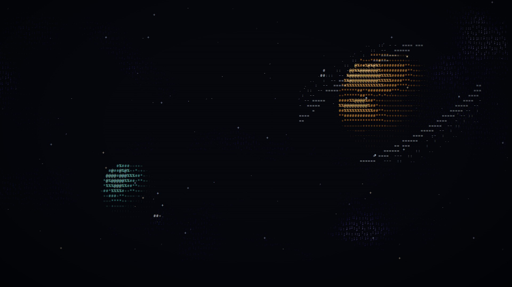

<div align="center">

# ASCII Wallpapers

**ASCII 文字で描くアニメーション壁紙 — [Wallpaper Engine](https://www.wallpaperengine.io/) とブラウザ向け。**

惑星も星も星雲も、すべて等幅フォントのグリフを `<canvas>` に描いて表現します。
画像も動画もネットワーク通信もありません。各壁紙は自己完結した Web プロジェクトです。

[](LICENSE)
[](https://www.wallpaperengine.io/)
[](#機能)
[](CONTRIBUTING.md)
[](https://github.com/NemoKing1210)

[English](README.md) · [Русский](README.ru.md) · [Español](README.es.md) · [Deutsch](README.de.md) · [Français](README.fr.md) · [Português (BR)](README.pt-BR.md) · [简体中文](README.zh-CN.md) · [**日本語**](README.ja.md)


</div>

## 機能

- **純粋な ASCII レンダリング** — 惑星、リング、恒星、星雲の塵はすべて文字で
  構成され、テクスチャは使いません。
- **オフラインで完結** — すべて壁紙フォルダ内にあり、実行時に何もダウンロード
  しません。
- **Wallpaper Engine から調整可能** — プロパティパネルで色、星の密度、
  グリフの大きさ、またたきを変更できます。
- **軽量** — アニメーションは 30 fps 上限、1600×900 で 1 フレーム約 4 ms。
- **オープンソース** — MIT ライセンス。壁紙の追加はフォルダ 1 つで完了します。

## 壁紙

| プレビュー | 壁紙 | シーン |
| :---: | --- | --- |
|  | **[ASCII Cosmos](wallpapers/cosmos)** | 輪を持つガス惑星、衛星を伴う氷の惑星、漂う星雲の塵、またたく星々、ときどき流れる流星 |

## Wallpaper Engine へのインストール

> Wallpaper Engine は Windows 専用です。

**方法 1 — エディタから読み込む**

1. Wallpaper Engine を開き、**Create Wallpaper** をクリックします。
2. エディタで **Open** をクリックし、壁紙の `project.json`（例:
   `wallpapers/cosmos/project.json`）を選択します。
3. ライブラリに壁紙が表示されるので、右クリックして **Apply** を選びます。

**方法 2 — フォルダをコピーする**

壁紙フォルダを `steamapps/common/wallpaper_engine/projects/myprojects/` に
コピーし、Wallpaper Engine を再起動します。

## ブラウザでプレビュー

壁紙はただの静的サイトなので、任意の静的サーバーで表示できます。
リポジトリのルートで:

```bash
npm run serve
# または: python -m http.server 8123
```

その後 <http://localhost:8123/wallpapers/cosmos/> を開きます。

`wallpapers/cosmos/index.html` を直接開いてもかまいません（ビルド不要）。
`?freeze=1.5` を付けると 1 フレームだけ決定的に描画します。

## 設定と内部の仕組み

各壁紙の Wallpaper Engine プロパティとレンダリング手法は、それぞれの README
にまとめてあります — [ASCII Cosmos](wallpapers/cosmos/README.md) を参照して
ください。

## リポジトリ構成

```
wallpapers/<name>/   自己完結した Wallpaper Engine プロジェクト
previews/            README で使うアニメーション GIF プレビュー
tools/               検証とローカルプレビュー用スクリプト
```

## 自分の壁紙を追加する

[CONTRIBUTING.md](CONTRIBUTING.md) を参照してください。壁紙は素の HTML/JS
なので、プルリクエストに必要なのはフォルダ、`project.json`、プレビュー画像
だけです。

## ライセンス

[MIT](LICENSE) © 2026 [NemoKing1210](https://github.com/NemoKing1210) と ASCII Wallpapers のコントリビューター · [セキュリティポリシー](SECURITY.md)

---

*他の言語: [English](README.md) · [Русский](README.ru.md) · [Español](README.es.md) · [Deutsch](README.de.md) · [Français](README.fr.md) · [Português (BR)](README.pt-BR.md) · [简体中文](README.zh-CN.md) · [日本語](README.ja.md)*
