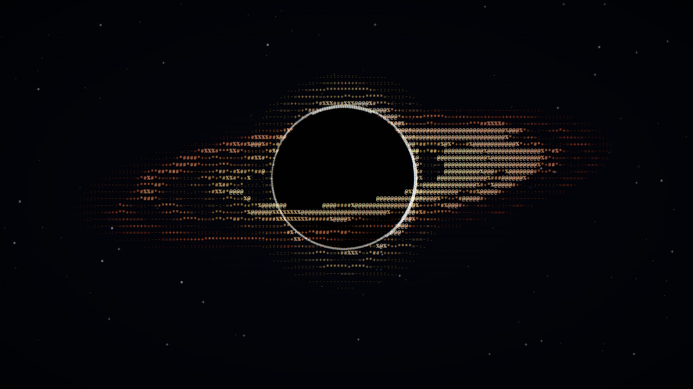

<div align="center">

# ASCII Wallpapers

**Papéis de parede animados desenhados com caracteres ASCII — para o [Wallpaper Engine](https://www.wallpaperengine.io/) e qualquer navegador.**

Cada planeta, estrela e nebulosa é desenhado com glifos monoespaçados em um `<canvas>`.
Sem imagens, sem vídeo e sem requisições de rede: cada papel de parede é um projeto web autônomo.

[](LICENSE)
[](https://www.wallpaperengine.io/)
[](#recursos)
[](CONTRIBUTING.md)
[](https://github.com/NemoKing1210)

[English](README.md) · [Русский](README.ru.md) · [Español](README.es.md) · [Deutsch](README.de.md) · [Français](README.fr.md) · [**Português (BR)**](README.pt-BR.md) · [简体中文](README.zh-CN.md) · [日本語](README.ja.md)


</div>

## Recursos

- **Renderização ASCII pura** — planetas, anéis, estrelas e poeira de nebulosa
  são construídos com caracteres, não com texturas.
- **Offline e autônomo** — tudo fica na pasta do papel de parede; nada é baixado
  durante a execução.
- **Ajustável no Wallpaper Engine** — cores, densidade de estrelas, tamanho dos
  glifos e cintilação pelo painel de propriedades.
- **Leve** — a animação é limitada a 30 fps e custa cerca de 4 ms por quadro em
  1600×900.
- **Código aberto** — licença MIT; adicionar um papel de parede é só uma pasta.

## Papéis de parede

| Prévia | Papel de parede | Cena |
| :---: | --- | --- |
|  | **[ASCII Cosmos](wallpapers/cosmos)** | Um gigante gasoso com anéis, um planeta gelado com sua lua, poeira de nebulosa à deriva, estrelas cintilantes e uma estrela cadente de vez em quando |
|  | **[ASCII Black Hole](wallpapers/blackhole)** | Um buraco negro com um disco de acreção luminoso, um fino anel de fótons e luz estelar curvada ao redor de sua sombra |

## Instalação no Wallpaper Engine

> O Wallpaper Engine roda no Windows.

**Opção 1 — importar pelo editor**

1. Abra o Wallpaper Engine e clique em **Create Wallpaper**.
2. No editor, clique em **Open** e selecione o `project.json` do papel de
   parede, por exemplo `wallpapers/cosmos/project.json`.
3. O papel de parede aparece na sua biblioteca — clique com o botão direito e
   escolha **Apply**.

**Opção 2 — copiar a pasta**

Copie a pasta do papel de parede para
`steamapps/common/wallpaper_engine/projects/myprojects/` e reinicie o
Wallpaper Engine.

## Prévia no navegador

Os papéis de parede são sites estáticos simples, então qualquer servidor
estático serve. Na raiz do repositório:

```bash
npm run serve
# ou: python -m http.server 8123
```

Depois abra <http://localhost:8123/> para a galeria de todos os papéis de
parede, ou <http://localhost:8123/wallpapers/cosmos/> para um deles.

Você também pode abrir `wallpapers/cosmos/index.html` diretamente — não há etapa
de build. Adicione `?freeze=1.5` para renderizar um único quadro determinístico.

## Configurações e detalhes internos

Cada papel de parede documenta suas propriedades do Wallpaper Engine e sua
técnica de renderização no próprio README — veja
[ASCII Cosmos](wallpapers/cosmos/README.md) e
[ASCII Black Hole](wallpapers/blackhole/README.md).

## Estrutura do repositório

```
index.html           galeria com todos os papéis de parede
wallpapers/<nome>/   projetos autônomos do Wallpaper Engine
previews/            prévias em GIF animado usadas nos READMEs
tools/               scripts de validação e pré-visualização local
```

## Adicione seu próprio papel de parede

Veja [CONTRIBUTING.md](CONTRIBUTING.md). Os papéis de parede são HTML/JS simples,
então um pull request só precisa de uma pasta, um `project.json`, uma imagem de
prévia e um cartão na galeria `index.html` da raiz.

## Licença

[MIT](LICENSE) © 2026 [NemoKing1210](https://github.com/NemoKing1210) e colaboradores do ASCII Wallpapers · [Política de segurança](SECURITY.md)

---

*Outros idiomas: [English](README.md) · [Русский](README.ru.md) · [Español](README.es.md) · [Deutsch](README.de.md) · [Français](README.fr.md) · [Português (BR)](README.pt-BR.md) · [简体中文](README.zh-CN.md) · [日本語](README.ja.md)*
