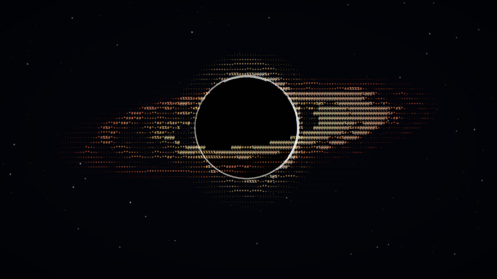

<div align="center">

# ASCII Wallpapers

**Анимированные обои, нарисованные ASCII-символами — для [Wallpaper Engine](https://www.wallpaperengine.io/) и любого браузера.**

Каждая планета, звезда и туманность рисуются глифами моноширинного шрифта на `<canvas>`.
Без картинок, видео и сетевых запросов: каждые обои — самостоятельный веб-проект.

[](LICENSE)
[](https://www.wallpaperengine.io/)
[](#возможности)
[](CONTRIBUTING.md)
[](https://github.com/NemoKing1210)

[English](README.md) · [**Русский**](README.ru.md) · [Español](README.es.md) · [Deutsch](README.de.md) · [Français](README.fr.md) · [Português (BR)](README.pt-BR.md) · [简体中文](README.zh-CN.md) · [日本語](README.ja.md)


</div>

## Возможности

- **Чистый ASCII-рендеринг** — планеты, кольца, звёзды и туманность
  складываются из символов, а не из текстур.
- **Офлайн и автономно** — всё лежит в папке обоев; при запуске ничего
  не скачивается.
- **Настройка в Wallpaper Engine** — цвета, плотность звёзд, размер глифов
  и мерцание через панель свойств.
- **Экономно** — анимация ограничена 30 fps и стоит около 4 мс на кадр
  при 1600×900.
- **Открытый код** — лицензия MIT; чтобы добавить обои, достаточно одной папки.

## Обои

| Превью | Обои | Сцена |
| :---: | --- | --- |
|  | **[ASCII Cosmos](wallpapers/cosmos)** | Газовый гигант с кольцами, ледяная планета с луной, дрейфующая туманность, мерцающие звёзды и редкая падающая звезда |
|  | **[ASCII Black Hole](wallpapers/blackhole)** | Чёрная дыра со светящимся аккреционным диском, тонким фотонным кольцом и искривлённым звёздным светом |

## Установка в Wallpaper Engine

> Wallpaper Engine работает только на Windows.

**Способ 1 — импорт через редактор**

1. Откройте Wallpaper Engine и нажмите **Create Wallpaper**.
2. В редакторе нажмите **Open** и выберите `project.json` нужных обоев,
   например `wallpapers/cosmos/project.json`.
3. Обои появятся в библиотеке — нажмите на них правой кнопкой и выберите
   **Apply**.

**Способ 2 — скопировать папку**

Скопируйте папку обоев в
`steamapps/common/wallpaper_engine/projects/myprojects/` и перезапустите
Wallpaper Engine.

## Проверка в браузере

Обои — обычные статические сайты, поэтому подойдёт любой статический сервер.
Из корня репозитория:

```bash
npm run serve
# или: python -m http.server 8123
```

Затем откройте <http://localhost:8123/> — галерея всех обоев, или
<http://localhost:8123/wallpapers/cosmos/> — отдельные обои.

Можно также открыть `wallpapers/cosmos/index.html` напрямую — сборка не нужна.
Добавьте `?freeze=1.5`, чтобы отрисовать один детерминированный кадр.

## Настройки и устройство

Свойства для Wallpaper Engine и описание техники рендеринга каждых обоев
находятся в их собственном README — см. [ASCII Cosmos](wallpapers/cosmos/README.md)
и [ASCII Black Hole](wallpapers/blackhole/README.md).

## Структура репозитория

```
index.html          галерея всех обоев
wallpapers/<имя>/   самостоятельные проекты для Wallpaper Engine
previews/           анимированные GIF-превью для README
tools/              скрипты проверки и локального просмотра
```

## Добавить свои обои

См. [CONTRIBUTING.md](CONTRIBUTING.md). Обои — это чистый HTML/JS, поэтому для
pull request нужны только папка, `project.json`, изображение-превью и карточка в
галерее `index.html` в корне репозитория.

## Лицензия

[MIT](LICENSE) © 2026 [NemoKing1210](https://github.com/NemoKing1210) и участники ASCII Wallpapers · [Политика безопасности](SECURITY.md)

---

*Другие языки: [English](README.md) · [Русский](README.ru.md) · [Español](README.es.md) · [Deutsch](README.de.md) · [Français](README.fr.md) · [Português (BR)](README.pt-BR.md) · [简体中文](README.zh-CN.md) · [日本語](README.ja.md)*
