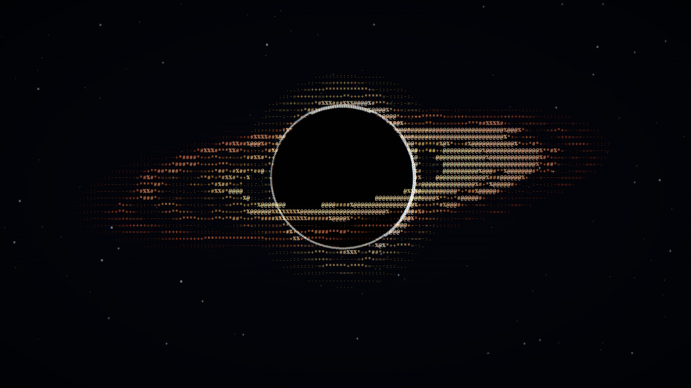

<div align="center">

# ASCII Wallpapers

**用 ASCII 字符绘制的动态壁纸——适用于 [Wallpaper Engine](https://www.wallpaperengine.io/) 和任意浏览器。**

每颗行星、恒星和星云都由等宽字符在 `<canvas>` 上绘制。
没有图片、没有视频、没有网络请求：每款壁纸都是一个自包含的网页项目。

[](LICENSE)
[](https://www.wallpaperengine.io/)
[](#功能)
[](CONTRIBUTING.md)
[](https://github.com/NemoKing1210)

[English](README.md) · [Русский](README.ru.md) · [Español](README.es.md) · [Deutsch](README.de.md) · [Français](README.fr.md) · [Português (BR)](README.pt-BR.md) · [**简体中文**](README.zh-CN.md) · [日本語](README.ja.md)


</div>

## 功能

- **纯 ASCII 渲染** —— 行星、光环、恒星和星云尘埃全部由字符构成，不使用纹理。
- **离线且自包含** —— 所有内容都在壁纸文件夹内，运行时不会下载任何东西。
- **可在 Wallpaper Engine 中调节** —— 通过属性面板调整颜色、恒星密度、字符大小和闪烁。
- **性能开销低** —— 动画上限 30 fps，1600×900 下每帧约 4 毫秒。
- **开源** —— MIT 许可；添加壁纸只需一个文件夹。

## 壁纸

| 预览 | 壁纸 | 场景 |
| :---: | --- | --- |
|  | **[ASCII Cosmos](wallpapers/cosmos)** | 带光环的气态巨行星、带卫星的冰封行星、漂浮的星云尘埃、闪烁的恒星，以及偶尔划过的流星 |
|  | **[ASCII Black Hole](wallpapers/blackhole)** | 带有明亮吸积盘、纤细光子环和围绕阴影弯曲的星光的黑洞 |

## 在 Wallpaper Engine 中安装

> Wallpaper Engine 仅支持 Windows。

**方式一：通过编辑器导入**

1. 打开 Wallpaper Engine，点击 **Create Wallpaper**。
2. 在编辑器中点击 **Open**，选择壁纸的 `project.json`，例如
   `wallpapers/cosmos/project.json`。
3. 壁纸会出现在你的库中——右键点击并选择 **Apply**。

**方式二：复制文件夹**

将壁纸文件夹复制到
`steamapps/common/wallpaper_engine/projects/myprojects/`，然后重启
Wallpaper Engine。

## 在浏览器中预览

壁纸都是普通的静态站点，任意静态服务器都可以。在仓库根目录运行：

```bash
npm run serve
# 或：python -m http.server 8123
```

然后打开 <http://localhost:8123/> 查看所有壁纸的图库，或打开
<http://localhost:8123/wallpapers/cosmos/> 查看单个壁纸。

也可以直接打开 `wallpapers/cosmos/index.html`——无需构建步骤。加上
`?freeze=1.5` 可渲染单帧确定性画面。

## 设置与实现细节

每款壁纸都会在自己的 README 中说明其 Wallpaper Engine 属性和渲染原理——
请参阅 [ASCII Cosmos](wallpapers/cosmos/README.md) 和
[ASCII Black Hole](wallpapers/blackhole/README.md)。

## 仓库结构

```
index.html         列出所有壁纸的图库
wallpapers/<名称>/   自包含的 Wallpaper Engine 项目
previews/            README 中使用的动态 GIF 预览
tools/               校验与本地预览脚本
```

## 添加你自己的壁纸

参见 [CONTRIBUTING.md](CONTRIBUTING.md)。壁纸就是纯 HTML/JS，因此 Pull Request
只需一个文件夹、一个 `project.json`、一张预览图和根目录 `index.html` 图库中的
一张卡片。

## 许可证

[MIT](LICENSE) © 2026 [NemoKing1210](https://github.com/NemoKing1210) 与 ASCII Wallpapers 贡献者 · [安全策略](SECURITY.md)

---

*其他语言：[English](README.md) · [Русский](README.ru.md) · [Español](README.es.md) · [Deutsch](README.de.md) · [Français](README.fr.md) · [Português (BR)](README.pt-BR.md) · [简体中文](README.zh-CN.md) · [日本語](README.ja.md)*
