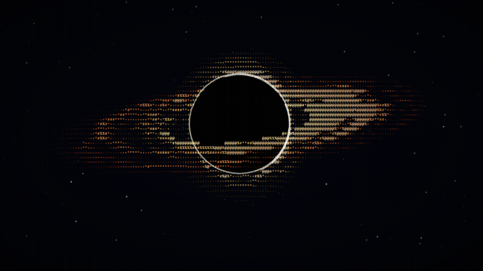

# ASCII Black Hole

[← All wallpapers](../../README.md)

An animated ASCII-art black hole for
[Wallpaper Engine](https://www.wallpaperengine.io/) and the browser: a dark
event horizon, a razor-thin photon ring, a glowing accretion disk with a
Doppler-bright side, and starlight bent around the hole — all drawn with
monospace glyphs on a single `<canvas>`.



## Settings

| Property | Default | Description |
| --- | --- | --- |
| Accretion disk color | `1 0.62 0.28` (`#FF9E47`) | Base color of the disk; the inner edge stays hotter and the outer edge cooler |
| Star density | `1.0` | Star count multiplier, 0.2–3.0 |
| Glyph size | `1.0` | Character scale, 0.7–1.8 |
| Disk speed | `1.0` | Orbital animation speed, 0–2.0; `0` freezes the rotation |
| Doppler beaming | `true` | Make the approaching side of the disk brighter |
| Twinkling stars | `true` | Animate star brightness |

Wallpaper Engine exposes these in the properties panel; changes apply live.

## Install

1. Open Wallpaper Engine → **Create Wallpaper**.
2. Click **Open** and pick this folder's `project.json`.
3. Apply the wallpaper from your library.

See the [main README](../../README.md#install-in-wallpaper-engine) for the
folder-copy method and other wallpapers.

## Preview in a browser

The folder is a plain static site, so any static server works. From the
repository root:

```bash
npm run serve
# or: python -m http.server 8123
```

Then open <http://localhost:8123/wallpapers/blackhole/>. Add `?freeze=1.5` to
render one deterministic frame.

## How it works

- **Shadow and photon ring** — the event horizon is a filled black circle. A
  dense ring of bright glyphs sits just outside it, with a slow shimmer.
- **Accretion disk** — the disk is projected as a very thin tilted ellipse.
  Every glyph cell is mapped into the disk plane once at resize time; each
  frame only advances cheap sine bands to animate the orbital flow. Brightness
  rises toward the inner edge, and a Keplerian Doppler term brightens the side
  moving toward the camera.
- **Lensed halo** — a second glyph band wraps the shadow. It is brightest at
  the top and bottom, standing in for the far side of the disk lifted by
  gravitational lensing.
- **Stars** — source stars are placed in a deterministic seeded field. Each
  star contributes two images through the point-lens equation
  `β = θ − K/θ`, which pushes stars away from the shadow and leaves a natural
  lensing void around the hole.
- **Occlusion** — the disk is drawn, the shadow is painted over it, then the
  near half of the disk is repainted in front of the shadow. The near half is
  precomputed, so the second pass touches only a few hundred cells.
- **Performance** — animation is capped at 30 fps. The background and all
  per-cell geometry are built once per resize; per-frame work is mostly glyph
  fills and a handful of sine operations.

## Files

| File | Purpose |
| --- | --- |
| `index.html` | Page shell, canvas and screen overlays |
| `main.js` | Renderer and Wallpaper Engine integration |
| `project.json` | Wallpaper Engine metadata and user properties |
| `preview.jpg` | 1920×1080 preview shown in the Wallpaper Engine browser |

## License

MIT — see [LICENSE](../../LICENSE). Maintained by
[NemoKing1210](https://github.com/NemoKing1210).
